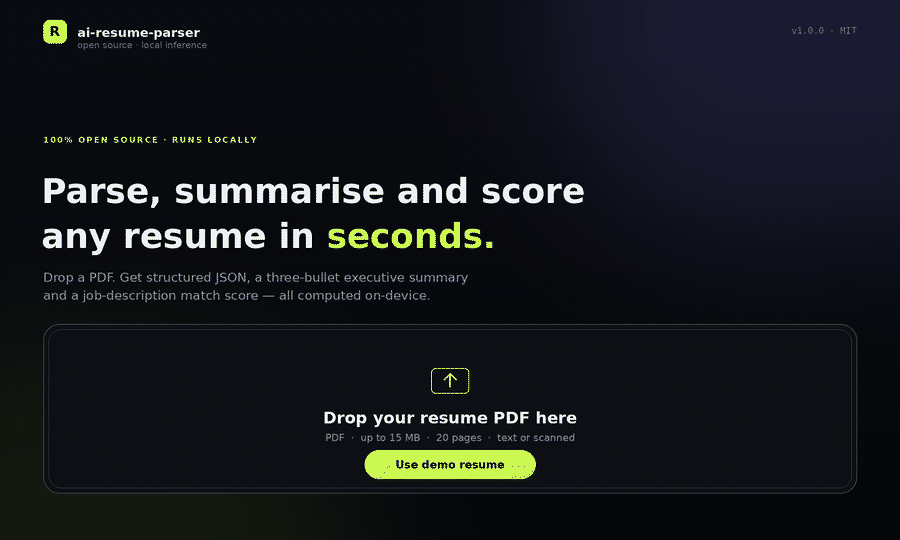

# ai-resume-parser

**Drop in a PDF resume. Get structured JSON, a three-bullet executive summary, and a job-description match score — computed entirely on your own machine.**

[](https://www.python.org/)
[](https://streamlit.io/)
[](LICENSE)
[](#offline-and-air-gapped-use)
[](tests/)

<div align="center">
  
</div>

<sub>The animation above is generated from the real pipeline output by `scripts/make_demo_gif.py` — no mocked screenshots.</sub>

---

## What it does

| | |
|---|---|
| **Reads PDFs** | Native text layer via PyMuPDF, with page/character caps, encrypted-file handling and multi-column text normalisation. |
| **Extracts structure** | Name, headline, email, phone, location, LinkedIn/GitHub, skills (categorised), experience (years + companies + per-role timeline), education, certifications, projects — each with a confidence score. |
| **Summarises** | Exactly three benchmark-quality bullets blending BART-large-CNN abstractive candidates with an MMR-ranked extractive pass, so the lines stay distinct, quantified and grounded. |
| **Matches a JD** | 0–100 score with a transparent four-way breakdown, matched/missing skill lists, and concrete suggestions to close the gap. |
| **Exports** | Versioned JSON (`schema_version`), one click to download; the same payload is shown in-app. |

Everything is open source and runs locally. No API keys, no per-resume cost, no candidate data leaving the host.

---

## Quick start

```bash
git clone https://github.com/<you>/ai-resume-parser.git
cd ai-resume-parser

python3.11 -m venv .venv
source .venv/bin/activate            # Windows: .venv\Scripts\activate

# 1. CPU-only PyTorch (~230 MB instead of ~2.7 GB of CUDA wheels)
pip install torch --index-url https://download.pytorch.org/whl/cpu

# 2. Everything else
pip install -r requirements.txt

# 3. Fetch BERT + BART once (~2.0 GB) and smoke-test them
python scripts/download_models.py --verify

# 4. Run
streamlit run app.py
```

Open <http://localhost:8501>, drop a PDF into the uploader (or press **Use demo resume**) and the four tabs populate.

> **No GPU required.** The reference machine is a 2-vCPU CPU-only Linux box. A warm one-page run takes about **33 s** end to end: BART-large-CNN generation ~21 s, BERT parsing ~6 s, matching ~6 s. The first run after launch adds ~30 s of model loading (~62 s total). Set `ENABLE_SUMMARIZER=false` to skip BART and take the much faster extractive-only path.

### Already have the weights?

```bash
python scripts/download_models.py --check     # exits 0 only if both models are complete
python scripts/download_models.py --ner-only  # ~430 MB, extraction without summarisation
```

### Offline and air-gapped use

```bash
python scripts/download_models.py --verify    # once, on a networked machine
cp .env.example .env
# OFFLINE_MODE=true
```

`OFFLINE_MODE=true` sets `HF_HUB_OFFLINE`/`TRANSFORMERS_OFFLINE`, so the app never attempts a network call and fails loudly instead of hanging if a weight file is missing. Copy the repo (including `models/weights/`) to the target host and it runs unchanged.

---

## How it works

```
            ┌──────────────┐
 PDF bytes ─▶  pdf_reader   │  PyMuPDF text layer, page/char caps,
            └──────┬───────┘  furniture stripping, whitespace repair
                   ▼
            ┌──────────────┐
            │  ner_parser   │  section detection + regex contact pass +
            └──────┬───────┘  ~200-term skill taxonomy + BERT NER hints
                   ▼
        ┌──────────┴───────────┐
        ▼                      ▼
┌───────────────┐      ┌───────────────┐      ┌──────────────┐
│  summarizer   │      │    matcher     │      │  exporters   │
│ BART + MMR    │      │ 4 weighted     │      │ versioned    │
│ 3 bullets     │      │ components     │      │ JSON         │
└───────────────┘      └───────────────┘      └──────────────┘
```

Design rule: **every stage degrades instead of crashing.** If BART is missing the summary falls back to a grounded extractive pass; if `sentence-transformers` isn't installed the matcher swaps in a TF-IDF cosine; if BERT can't load, extraction still runs on regex + taxonomy. The UI marks which path was used (`degraded` / `strategy` in the JSON) so results are never silently faked.

### Extraction

1. **Normalise** — NFKC, ligature repair, bullet/whitespace collapse, hyphenated line-wrap rejoin, page furniture removal (page numbers, repeated headers).
2. **Segment** — heading detection with a synonym table (`Experience`, `Work History`, `Employment`, `Projects`, `Education`, `Skills`, …) tolerant of casing, punctuation and trailing colons.
3. **Contact** — anchored regexes for email/phone/URLs plus a location heuristic that handles `City, ST`, `City | Country` and `City — Country`.
4. **Skills** — curated taxonomy of ~200 technologies with aliases (`torch`→PyTorch, `k8s`→Kubernetes, `postgres`→PostgreSQL), category inference, and a JD-side extractor that weights skills by requirement cues (`must have`, `required`, `nice to have`).
5. **Experience** — date-range parsing across `Jan 2020 – Present`, `2019-2021`, `03/2021`, `Summer 2018`; inclusive month arithmetic; title/company split using role and legal-suffix vocabularies.
6. **Education** — degree ranking (PhD > Master's > Bachelor's > Diploma), institution extraction with false-positive guards, field-of-study detection.

### Summarisation

BART produces candidates from up to two chunks of the resume; a sentence-level scorer (metric density, action verbs, seniority, recency, credential weighting) and an MMR pass pick three that are **diverse** and **grounded in extracted facts**. Contact lines, URLs and section headers are filtered out before scoring. The result is deterministic across runs (`do_sample=False`).

### Match scoring

| Component | Default weight | What it measures |
|---|---:|---|
| Skill coverage | 50% | Weighted overlap between JD-required skills and resume skills (requirement cues raise a skill's weight to 1.9×). |
| Semantic similarity | 25% | Cosine similarity of resume↔JD embeddings; falls back to TF-IDF when no encoder is available. |
| Experience fit | 15% | Resume years vs the JD's stated minimum (`5+ years`), saturating at 100%. |
| Education fit | 10% | Highest degree found vs the degree the JD asks for. |

Components that don't apply (e.g. the JD names no skills, or states no degree) are dropped and the remaining weights are **re-normalised**, so a JD without a degree requirement can't be penalised for it. Verdicts: `≥80` Excellent · `≥65` Strong · `≥50` Moderate · `≥35` Partial · `<35` Low.

Weights are configurable via `MATCH_WEIGHT_*` environment variables.

---

## JSON contract

`utils/exporters.py` pins `SCHEMA_VERSION = "1.0"`. Abridged real output:

```json
{
  "schema_version": "1.0",
  "generated_at": "2026-10-27T21:09:34+00:00",
  "generator": { "name": "ai-resume-parser", "version": "1.0.0" },
  "source": {
    "filename": "aarav_mehta_resume.pdf",
    "bytes": 8226,
    "sha256_16": "47991c03cf0b4b91",
    "page_count": 1,
    "pages_used": 1,
    "char_count": 1951,
    "word_count": 280,
    "is_scanned": false,
    "ocr_used": false,
    "truncated": false
  },
  "extraction": {
    "name": "Aarav Mehta",
    "headline": "Senior Machine Learning Engineer",
    "contact": {
      "email": "aarav.mehta@example.com",
      "phone": "+91 98200 41122",
      "location": "Bengaluru, India",
      "linkedin": "https://linkedin.com/in/aaravmehta",
      "github": "https://github.com/aaravmehta",
      "links": ["https://linkedin.com/in/aaravmehta", "https://github.com/aaravmehta"]
    },
    "skills": [
      {
        "name": "PyTorch",
        "category": "Data & ML",
        "occurrences": 3,
        "in_skills_section": true,
        "confidence": 1.0
      }
    ],
    "experience": {
      "years": 9.3,
      "years_source": "dates",
      "companies": ["Nimbus Analytics", "Vertex Labs", "Bluewave Systems"],
      "titles": [
        "Senior Machine Learning Engineer",
        "Machine Learning Engineer",
        "Data Scientist"
      ],
      "entries": [
        {
          "title": "Senior Machine Learning Engineer",
          "company": "Nimbus Analytics",
          "start": "Jan 2022",
          "end": "Present",
          "duration_months": 57,
          "description": "Owned the end-to-end ranking pipeline (PyTorch, Airflow, Kubernetes); reduced inference cost by 38%."
        }
      ]
    },
    "education": {
      "highest_level": "Master's",
      "institutions": ["Indian Institute of Technology, Bombay", "VIT University"]
    },
    "confidence": { "overall": 0.96 }
  },
  "summary": {
    "bullets": [
      "Aarav Mehta is a senior machine learning engineer at Nimbus Analytics.",
      "Machine learning engineer with 8 years of experience shipping production NLP and recommendation systems.",
      "Owned the end-to-end ranking pipeline (PyTorch, Airflow, Kubernetes); reduced inference cost by 38%."
    ],
    "model": "facebook/bart-large-cnn",
    "strategy": "abstractive+extractive",
    "degraded": false
  },
  "job_match": {
    "score": 87,
    "verdict": "Excellent match",
    "coverage": 73.2,
    "semantic_similarity": 1.0,
    "semantic_method": "bert-mean-pooling",
    "matched_skills": [
      { "name": "PyTorch", "required": true, "weight": 1.9, "occurrences": 1 }
    ],
    "missing_skills": [
      { "name": "MLOps", "required": true, "weight": 1.9, "occurrences": 1 },
      { "name": "Rust", "required": false, "weight": 0.65, "occurrences": 1 }
    ],
    "breakdown": [
      {
        "key": "skills",
        "label": "Skill coverage",
        "score": 73.2,
        "weight": 50.0,
        "detail": "6/10 JD skills found",
        "applicable": true
      }
    ],
    "recommendations": ["Add concrete evidence of MLOps — the JD marks it as required."]
  },
  "meta": { "offline": false, "pipeline_ms": 33115 }
}
```

The `source` block is the provenance record: `sha256_16` lets you correlate an exported result with the exact PDF that produced it without retaining the file.

---

## Project layout

```
.
├── app.py                      Streamlit UI (4 tabs, dark theme, JSON download)
├── parsers/
│   ├── pdf_reader.py           PDF → clean text (PyMuPDF)
│   └── ner_parser.py           Text → ParsedResume (sections, contacts, skills, dates)
├── models/
│   ├── registry.py             Lazy model cache, device selection, health status
│   ├── summarizer.py           BART + extractive MMR → 3 bullets
│   └── matcher.py              Resume ↔ JD scoring
├── utils/
│   ├── config.py               .env-driven settings (dataclass, validated)
│   ├── skills.py               ~200-skill taxonomy, aliases, JD cue weighting
│   ├── text_utils.py           Sentence/date/experience helpers
│   ├── validators.py           Upload guards, safe filenames
│   ├── exporters.py            Versioned JSON payload
│   ├── theme.py                Design system + HTML components
│   └── sample.py               Synthetic demo resume (no real candidate data)
├── scripts/
│   ├── download_models.py      Provision + verify weights offline
│   └── make_demo_gif.py        Regenerate assets/demo.gif from real output
├── tests/                      145 pytest tests, no network or weights required
├── assets/styles.css           UI styling
└── .streamlit/config.toml      Theme + upload limits
```

---

## Configuration

Copy `.env.example` to `.env`; every value is optional.

| Variable | Default | Notes |
|---|---|---|
| `NER_MODEL_ID` | `dslim/bert-base-NER` | Any token-classification checkpoint. |
| `SUMMARIZER_MODEL_ID` | `facebook/bart-large-cnn` | Swap for `sshleifer/distilbart-cnn-12-6` on small hosts. |
| `MODEL_CACHE_DIR` | `models/weights` | Relative paths resolve against the repo root. |
| `OFFLINE_MODE` | `false` | Blocks all Hugging Face network access. |
| `DEVICE` | `auto` | `auto` \| `cpu` \| `cuda`. |
| `ENABLE_NER` / `ENABLE_SUMMARIZER` / `ENABLE_EMBEDDINGS` | `true` | Turn components off to cut RAM. |
| `MAX_UPLOAD_MB` | `15` | Also enforced by Streamlit's `maxUploadSize`. |
| `MAX_PDF_PAGES` | `20` | Page cap per document. |
| `SUMMARY_BULLETS` | `3` | Exactly this many bullets (clamped to available facts). |
| `MATCH_WEIGHT_SKILLS` … | `0.50` / `0.25` / `0.15` / `0.10` | Auto re-normalised. |
| `LOG_LEVEL`, `LOG_DIR` | `INFO`, `logs` | Rotating file log. |
| `DEMO_MODE` | `false` | Preloads the synthetic resume for screenshots. |

### Use as a library

```python
from parsers.pdf_reader import read_pdf
from parsers.ner_parser import get_parser
from models.summarizer import get_summarizer
from models.matcher import match_resume_to_jd

document = read_pdf(open("resume.pdf", "rb").read(), filename="resume.pdf")
resume = get_parser().parse(document.text).to_dict()

summary = get_summarizer().summarize(document.text, bullets=3, context=resume)
match = match_resume_to_jd(resume, job_description, resume_text=document.text)

print(summary.bullets)
print(match.score, match.missing_skills)
```

Pass `use_ner=False` to `get_parser()` for regex-only extraction with zero model loads, or supply your own `ModelRegistry` to reuse loaded weights.

---

## Testing

```bash
pip install -r requirements-dev.txt
pytest -q                       # 145 passing in ~10s, no network
ruff check .                    # clean
```

The suite injects an `OfflineRegistry` stub, so it exercises the degradation paths (missing NER, missing BART, no encoder) rather than requiring a 2 GB download. That is deliberate: the fallbacks are the parts most likely to break silently.

---

## Troubleshooting

| Symptom | Fix |
|---|---|
| `OSError: We couldn't connect to huggingface.co` | Weights are missing and `OFFLINE_MODE=true`. Run `python scripts/download_models.py --verify` while online, or point `MODEL_CACHE_DIR` at an existing copy. |
| Summary reads *"extractive"* in the UI | BART didn't load (OOM or missing weights). Extraction and matching are unaffected; the fallback bullets are still factual. |
| Scanned PDF returns empty text | Enable OCR: `pip install pytesseract`, install Tesseract, set `ENABLE_OCR=true`. |
| First request is slow (~60 s) | Model load, not inference. Press **Warm up models** in the sidebar, or keep the app running. |
| `Killed` on a 2 GB host | Set `ENABLE_SUMMARIZER=false`; peak RSS drops to roughly 450 MB. |
| Experience years look generous | Ranges are counted inclusively (`Jan 2020 – Dec 2020` = 12 months), and overlapping roles are merged. |

---

## Privacy, scope and honest limits

- **Local by default.** PDF bytes are processed in memory, never written to disk, and never uploaded. Only Hugging Face model downloads touch the network, and only when you run the provisioning script.
- **No accuracy theatre.** Extraction is heuristic + NER, not a trained resume model. Unusual templates, heavy tables, and graphics-only layouts degrade gracefully but can miss fields — the per-field `confidence` and the **Raw extracted text** viewer exist so you can see exactly what the parser saw.
- **Scanned PDFs need OCR** and are opt-in, because Tesseract is an extra system dependency.
- **Not a hiring decision system.** The match score is an explainable heuristic for prioritising applications; it is not a validated predictor of job performance and should not be used as an automated screening gate.

MIT licensed. Models keep their own licences (BERT: Apache-2.0, BART-large-CNN: MIT).
